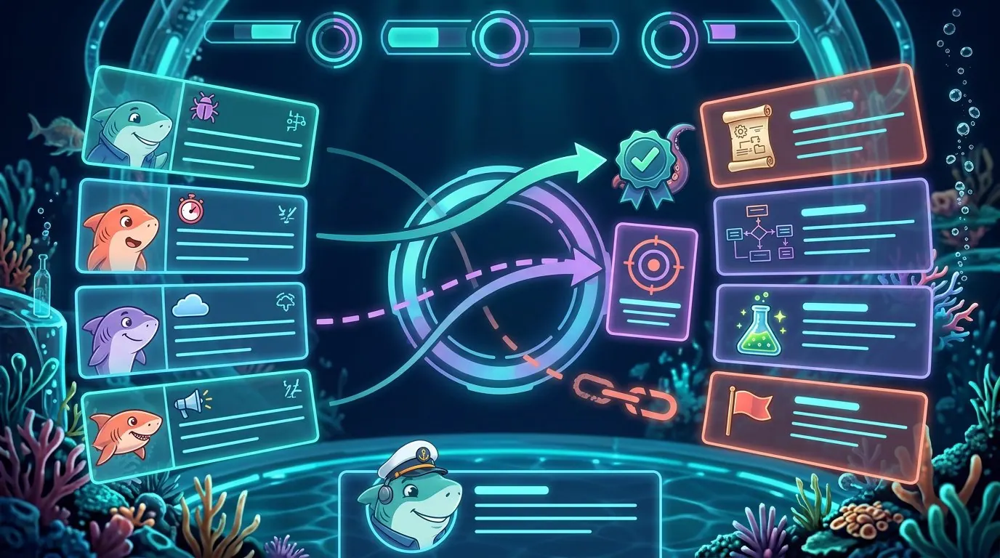
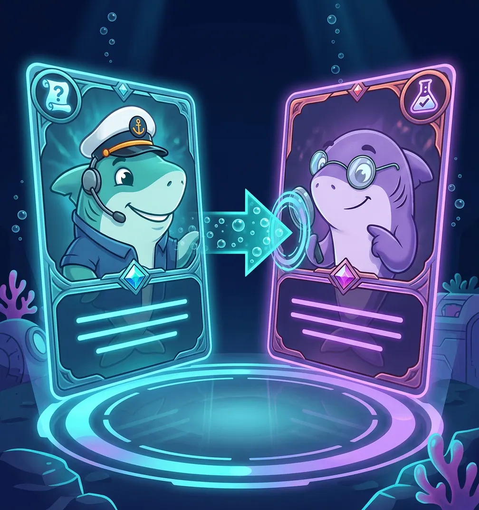
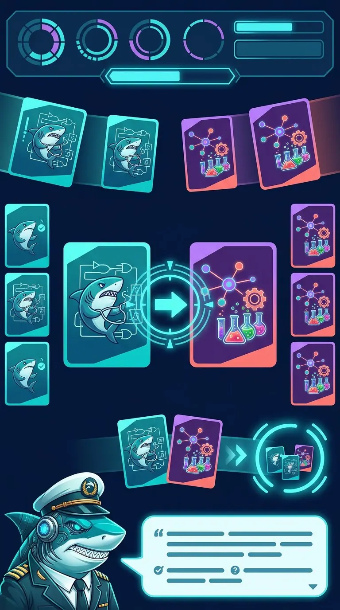

# 050 — Konsep Visual MatchingShark: Kartu Hiu Berhadap-hadapan + Panah Sonar

Tanggal: 2026-10-29 17:17 WIB
Status: konsep visual selesai secara lokal pada branch
`arena/1fa1f349-codeshark-qwen3-8max2`; belum commit/push. Pemilik
proyek kemudian memilih arah card versus, dan prototipe interaktifnya
sudah dibuat serta dicatat pada dokumen 051. Dokumen ini tetap menjadi
referensi konsep visual dan alasan desainnya.

## Masukan dari demo saat ini

Screenshot demo `/matchingshark/#demo` menunjukkan fungsi matching
sudah benar, tetapi model visualnya masih terasa seperti formulir dua
kolom:

- kartu berbentuk baris horizontal panjang, bukan kartu koleksi;
- pasangan yang sudah benar hanya berubah warna dan mendapat centang;
- kartu situasi pertama sebenarnya berpasangan dengan kartu keputusan
  ketiga, tetapi hubungan itu tidak terlihat secara spasial;
- area tengah kosong, padahal di situlah drama "dua kartu saling
  menemukan" seharusnya terjadi;
- belum ada arah baca visual dari **situasi → artefak/keputusan**.

Usulan arah baru: **kartu hiu di kiri dan kanan saling berhadapan**,
dengan **panah sonar** sebagai penghubung semantik di tengah arena.

## Tiga konsep gambar

### A. Board desktop — Sonar Link Arena

Kekuatan:

- struktur kiri–tengah–kanan langsung terbaca;
- panah solid, panah putus-putus, segel centang, dan rantai putus
  sudah membedakan status pasangan;
- HUD atas dan dock feedback Kapten Hiu terasa seperti game;
- cocok sebagai acuan layout desktop/tablet.

Batas: kartu masih horizontal. Untuk implementasi final, kartu perlu
dibuat lebih portrait dan berkarakter seperti konsep B.

### B. Card duel — pasangan terpilih berhadap-hadapan

Kekuatan:

- inilah momen emosional utama: dua kartu besar saling menatap;
- panah gelembung kiri → kanan dan ring pengunci membuat hubungan
  terasa fisik;
- anatomi kartu jelas: ikon kategori, portrait hiu, gem tingkat
  kesulitan, dan area teks;
- cocok untuk state *selected*, *evaluating*, *match success*, serta
  visual campaign.

Batas: hanya menampilkan satu pasangan; belum menyelesaikan navigasi
banyak kartu dalam satu misi.

### C. Board mobile — pasangan aktif di tengah, kartu lain di rel tepi

Kekuatan:

- pasangan aktif tetap besar dan berhadap-hadapan di tengah;
- kartu lain mengintip dari rel kiri/kanan sehingga layar sempit tidak
  dipaksa memuat dua kolom teks penuh;
- pasangan selesai dapat masuk dock koleksi;
- bubble Kapten Hiu di bawah menjadi tempat feedback.

Batas: ikon kartu kecil pada gambar masih generik/berulang. Pada
implementasi, rel tepi cukup menampilkan ikon + warna kategori; teks
lengkap hanya tampil pada kartu aktif di tengah.

## Rekomendasi: model hibrida "Sonar Link Arena"

Gabungkan ketiganya:

- **layout board** dari konsep A;
- **momen face-off dan anatomi kartu** dari konsep B;
- **staging mobile** dari konsep C.

### Layout desktop

1. **Kolom kiri — Kartu Situasi**
   - kartu portrait sedikit miring menghadap kanan;
   - portrait hiu sesuai peran/kategori, ikon situasi, judul pendek,
     dan 2–3 baris konteks;
   - socket panah berada di tepi kanan kartu.
2. **Tengah — Sonar Link Arena**
   - lingkaran sonar menjadi panggung pasangan aktif;
   - panah Bézier ditarik dari socket kiri ke socket kanan;
   - pasangan terverifikasi tetap mempunyai garis tipis persisten,
     tidak hanya berubah warna.
3. **Kolom kanan — Kartu Artefak/Keputusan**
   - kartu portrait miring menghadap kiri;
   - ikon artefak besar (SRS, use case, class, test, Sprint flag),
     label keputusan, dan gem kesulitan;
   - socket berada di tepi kiri kartu.
4. **Bawah — Captain Feedback Dock**
   - alasan benar/salah, hint, tombol ulangi, progres pasangan, dan
     dampak ke Sprint.

### Alur interaksi

1. Pemain mengetuk/menyeret kartu situasi. Kartu terangkat, miring ke
   tengah, socket-nya menyala.
2. Panah putus-putus violet mengikuti pointer atau otomatis menunjuk
   kartu keputusan yang sedang dihover/difokuskan.
3. Saat pasangan dipilih, kedua kartu meluncur ke arena tengah dan
   berhadap-hadapan seperti konsep B.
4. **Benar:** panah menjadi solid teal, ring terkunci, segel centang
   muncul, kartu berdenyut lalu kembali ke posisi dengan garis
   persisten atau masuk dock pasangan selesai.
5. **Salah:** panah berubah coral, rantai putus, kedua kartu mundur
   sedikit; Kapten menjelaskan mengapa maknanya tidak cocok.
6. **Hint:** sonar ping menyorot warna socket/kategori yang relevan
   dan meredupkan pengecoh yang paling tidak berhubungan.

Click-to-match tetap dipertahankan sebagai fallback drag. Keyboard
harus dapat memilih kartu dengan Tab, menghubungkan dengan Enter, dan
membatalkan dengan Escape; status diumumkan lewat `aria-live`.

### Semantik arah panah

| Visual | Makna |
|---|---|
| Panah solid cyan kiri → kanan | situasi/kebutuhan diterjemahkan menjadi artefak/keputusan |
| Panah putus-putus violet | kandidat sedang dipilih/drag |
| Segel centang teal pada ring | pasangan terverifikasi benar |
| Rantai coral putus | hubungan makna tidak cocok |
| Panah dua arah amber (level lanjut) | traceability, misalnya kebutuhan ↔ kasus uji |

Panah satu arah tidak boleh dipaksakan untuk semua relasi RPL. Relasi
yang memang dua arah perlu tipe link tersendiri agar visual tidak
mengajarkan model yang keliru.

### Layout mobile

Jangan mengecilkan dua kolom desktop. Gunakan staging:

- kartu belum selesai tampil sebagai rel ikon di tepi kiri/kanan;
- kartu situasi aktif membesar di tengah kiri;
- kandidat keputusan membesar di tengah kanan atau digeser sebagai
  carousel vertikal;
- pasangan aktif selalu berhadap-hadapan dengan panah besar;
- feedback menjadi bottom sheet Kapten Hiu;
- target sentuh kartu aktif minimal 56 px dan teks tidak dipadatkan.

## Catatan produksi aset

Gambar hasil generate adalah **moodboard/key visual**, bukan UI final
yang boleh dipotong apa adanya:

- teks misi harus tetap DOM agar dapat dicari, diterjemahkan, dan
  diakses screen reader;
- frame kartu, socket, segel, dan panah sebaiknya CSS/SVG;
- portrait hiu dan ikon artefak dibuat sebagai aset terpisah;
- panah digambar sebagai SVG overlay berdasarkan posisi socket nyata;
- PixiJS cukup untuk gelembung/sparkle perayaan secara lazy;
- efek suara memakai WebAudio synth yang sudah ada;
- `prefers-reduced-motion` mematikan bobbing/tilt dan mengganti
  animasi panah dengan garis statis.

## Inventaris file konsep

Seluruh file berada di `src/assets/matchingshark/concepts/`. Setelah
prototipe pada dokumen 051 dibuat, `matching-card-duel.png/.webp`
dipakai sebagai backdrop halus arena; board desktop/mobile tetap
menjadi referensi konsep dan belum diimpor aplikasi:

| File | Format | Dimensi | Ukuran |
|---|---|---:|---:|
| `matching-board-faceoff.jpg` | JPG | 1376×768 | 216 KiB |
| `matching-board-faceoff.webp` | WebP | 1376×768 | 119 KiB |
| `matching-card-duel.png` | PNG | 1008×1072 | 375 KiB |
| `matching-card-duel.webp` | WebP | 1008×1072 | 96 KiB |
| `matching-board-mobile.jpg` | JPG | 768×1376 | 193 KiB |
| `matching-board-mobile.webp` | WebP | 768×1376 | 99 KiB |

Derivasi WebP dan kompresi PNG dilakukan dengan Sharp. PNG duel turun
dari 2443 KiB menjadi 375 KiB tanpa mengubah dimensi.

## Keputusan dan tindak lanjut

Pemilik proyek memilih UI/UX seperti game card versus. Implementasi
yang dipilih adalah **Hibrida Sonar Link Arena**: struktur board A,
momen face-off B, dan prinsip staging mobile C.

Prototipe interaktifnya sudah dibuat pada komponen
`src/matchingshark/MatchingDemo.tsx` menggunakan kartu DOM, drag
`@dnd-kit` + fallback klik, slot versus, panah SVG, dan dock link
terverifikasi. Detail implementasi serta validasinya dicatat pada
dokumen 051. Ini masih prototipe demo lokal, bukan pembangunan
seluruh game atau sprite batch final.
